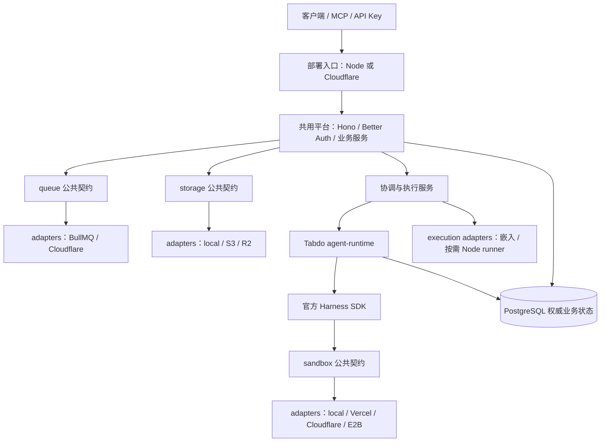

# tabdo 双部署模式架构

日期：2026-10-14。本文是实施依据。**按能力组织公用包，供应商实现置于包内 adapters；部署模式只存在于应用启动入口。** 实际完成情况见实施记录，不能把目标架构当作已经上线。参考 [Pars 核心层调研](pars-review.md)。

## 1. 目标与不可变边界

支持传统 Node + Redis 和 Cloudflare 两种模式，用户、客户端、MCP 和 Tabdo 业务无感知。共用产品 API、Better Auth、权限、PostgreSQL 业务数据、原生 Session/Run、Skill 和聊天协议。

底层框架使用 TypeScript、Web 标准与显式依赖。**能力包不依赖产品业务**，不读取全局环境，不探测运行时，不维护跨请求 principal。保留官方 HarnessAgent 和原生模型/工具循环。

能力、供应商、部署模式是三个不同维度：queue 是能力，BullMQ/Cloudflare Queues 是实现，Node/Cloudflare 是装配方式。Sandbox 供应商与部署模式也独立。

## 2. 分层与依赖方向



箭头表示调用与依赖方向；适配器由部署入口显式选择。底层包不反向 import platform/shared、表格命令、自动化规则、成员信息或数据库 schema。默认 index 只导出公用契约，不从 barrel 一起导出 Node 与 CF 实现。

## 3. 包职责与目录

| 包 / 入口 | 拥有的内容 | 不拥有的内容 |
| --- | --- | --- |
| `@tabdo/queue` | 通用消息 envelope、publisher、消费 ACK/重试；`adapters/bullmq`、`adapters/cloudflare` | automation 消息格式、generation、业务去重、Outbox 表与 Run 创建 |
| `@tabdo/storage` | 对象 put/open/remove、流式字节、可移植 key；`adapters/local`、`adapters/s3`、`adapters/r2` | 文件字段、上传限额、UUID 分片规则、文件归属、表格与租户权限 |
| `@tabdo/harness`（按实际复用提取） | 官方 SDK 组装、原生恢复与能力校验；供应商相关代码放 `adapters/` | Tabdo 智能体配置、工作区成员、会话分类、业务工具命令；不另造 agent loop |
| `@tabdo/sandbox` | 复用官方 SDK 文件/命令/网络会话契约；供应商实现放 `adapters/` | Tabdo Run 状态、数据库凭证、业务动作 |
| `@tabdo/execution` | 通用执行环境启动、查找、终止与资源引用；嵌入/按需 runner 实现放 `adapters/` | 自动化触发规则、聊天历史、Run 的权威业务终态 |
| `@tabdo/platform` | Hono app factory、Better Auth、业务命令/权限、PG repository、事件/Outbox、Run/Session 服务 | Node serve、Wrangler binding 配置、供应商消费循环 |
| `@tabdo/agent-runtime` | Tabdo 人设/Skill/工具与执行上下文装配，聊天/自动化/定时共用执行与检查点保存 | 再实现一套 SDK 原生工具、计划、目标或 read_skill |
| `@tabdo/shared` / `@tabdo/ui` | 产品 API/Zod schema、业务消息协议、客户端类型与 UI | 部署模式选择和适配器装配 |
| `apps/server` / 未来 CF 入口 / runner 镜像 | 环境解析、身份配置、能力组合、绑定、HTTP/后台启动与生命周期 | 另一套产品业务实现 |

不为目录齐全预先造空包。当前 `core` 只有业务队列消息和文件 key，迁移后移除；未来真正公用的错误、日志、上下文或 typed service/transport 有调用者时再提取小 kernel。不要把所有能力 contract 集中塞进 core。

```text
packages/queue/src/
  index.ts                  # 通用契约，edge-safe
  adapters/bullmq.ts         # 通用 BullMQ 实现
  adapters/cloudflare.ts    # 通用 CF binding 实现
packages/storage/src/
  index.ts                  # 通用字节接口，edge-safe
  adapters/local.ts
  adapters/s3.ts
  adapters/r2.ts
apps/server/src/queue/       # Tabdo automation 的装配与消费业务
apps/server/src/storage/     # 上传、元信息、文件 namespace 与权限
```

供应商库为 optional peer，并在包开发时安装。使用某适配器的应用显式安装对应 SDK；CF 的默认入口和 CF 子路径不导入 BullMQ、AWS SDK、Node 文件系统或宿主 Pi。

## 4. 通用契约与业务边界

### Queue

```ts
type QueueMessage<T> = Readonly<{ id: string; body: T }>;
interface QueuePublisher<T> {
  publish(message: QueueMessage<T>): Promise<void>;
  close?(): Promise<void>;
}
```

通用包只验证 envelope，消费 callback 收到不可信 payload，由业务 handler 解析。稳定 id 由调用者生成；CF provider message ID 与应用 id 分开。不把供应商 ACK 当业务去重保证，不承诺跨供应商优先级、getJob 或 exactly-once。

Tabdo 的 `{protocol, eventId, generation}` 在 `shared` 业务契约中。平台 relay 校验 payload、生成 `automation-<eventId>-<generation>`，再调用 `publisher.publish({id, body})`。BullMQ 队列名与任务名在应用入口配置，底层工厂叫 `createBullMQPublisher`，不叫 `createAutomationQueue`。

供应商消费循环留在 `adapters`。ACK 表示 callback 成功；**本平台 callback 必须在持久接受执行后返回**，不把完整 agent turn 塞进 CF queue handler。实际重试边界与 DLQ 由部署配置。

### Storage

公用接口只有 put/open/remove。支持普通相对对象 key，例如 `reports/weekly.txt`；底层不能强制 Tabdo 的 `<UUID前两位>/<UUID>`。本地适配器必须阻止绝对路径、路径穿越及非法分隔符。字段归属、UUID namespace、25MB 等上传限制在平台层执行，两种部署共用。

S3 和 R2 都是私有字节后端；不为直接访问 bucket 绕过平台权限。数据库存文件元信息与逻辑位置，旧对象读取配置必须可追溯。统一接口不代表所有供应商都支持相同的条件写入或热迁移能力。

### Harness、Sandbox 与 Execution

Harness 管理原生模型/工具循环和 Session continuation；Sandbox 提供文件、命令与网络环境；Execution 启动**承载完整 Harness 控制进程**的计算资源。三者分别装配，不能把“更换文件/命令 Sandbox”当作“Pi 模型循环已经迁到云端”。

复用官方 SDK 的 sandbox 类型，不造另一套同义文件 API。Tabdo agent-runtime 负责把产品配置和业务工具注入官方运行器。底层适配器接受显式配置/回调，不读取 organization/member/automation 表。

## 5. 两种部署的组合

| 能力 | A：Node | B：Cloudflare |
| --- | --- | --- |
| 产品 HTTP 与身份 | 共同 Hono app + Better Auth，Node serve | 同一 app/auth factory，Worker bindings 按请求注入 |
| Queue | `queue/adapters/bullmq` | `queue/adapters/cloudflare` |
| Storage | `storage/adapters/local` 或 `s3` | `storage/adapters/r2` 或 `s3` |
| 数据库 | Postgres.js pool | Postgres.js + Hyperdrive，请求作用域连接和关闭 |
| 调度唤醒 | 后台 due-schedule 扫描 | Cron/必要的 Alarm 唤醒相同业务调度函数 |
| 协调 | Node 生命周期 + PG fence | 每 Session 一个 DO + 同一 PG fence |
| 完整智能体执行 | 嵌入、独立 Node runner 或按需环境 | 按需 Node-compatible runner，保持现有官方 Harness |
| 聊天输出 | 公共 AI SDK UI SSE | 相同公共 SSE，DO 内部桥接，不更换客户端协议 |

部署入口拥有供应商名和绑定配置；业务服务只获得契约。CF 无须切换到 Pi Durable，也不要求唯一 Sandbox 供应商。共享代码必须在真实入口被调用，不能靠 CF 代理整个常驻 Node 服务宣称两模式实现完毕。

## 6. Run、Session 与事件可靠性

Session 是长期原生上下文，Run 是一次输入或未完成 turn 的续接。新消息创建新 Run 并恢复同一 Session；回答问题继续原 Run。一个 Session 同时最多一个执行者，不同 Session 可并发。

聊天、定时、数据自动化共用 Tabdo Run 服务。定时保留 IANA 时区、版本/计划时刻唯一 occurrence、停机合并和独立 scheduled_task 会话类型。纯数据动作不启动 Sandbox。

业务修改、触发快照、动作计划与 Outbox 同一 PG 事务。Relay 领取 token/fence 后提交事务，再投递并确认；确认失败可能重复投递。业务 receipt、当前 generation 与 fence 共同保证已提交修改不重放，这些规则属于平台，不进入 queue 包。

队列持久接受后，执行器与协调层管理长任务。CF queue/cron/alarm 的 wall-time 边界不能成为 agent 的隐含执行上限。启动 ACK 不明时按稳定执行身份核对，不重新调用已执行工具。

PG 是 Run/Session/权限的权威来源。DO 仅保存可重建协调信息、订阅游标或 alarm；不建第二份业务状态，不集中全部 Session。Redis 并发锁只是供应商协调实现；业务正确性仍由 PG fence 保证。

## 7. 恢复、取消与权限

保存原生 resume state、未完成工具调用 ID、已接受答案、环境引用、工作区快照和 stream cursor。生产恢复不能依赖进程 Map 中的活对象。先保存 continuation/工作区，再按供应商真实能力暂停或释放；不支持的能力明确失败。

恢复提交本次输入/答案，不从 UI 历史重放工具。取消先持久化再通知执行者；浏览器断开只断开订阅。最终消息、检查点、Run 终态原子提交。

Better Auth/用户 API Key 产生实际 principal。队列 body、URL 和内部 RPC 中的用户/组织 ID 不能直接成为身份。每次工具写入仍在同一事务中复核当前成员资格、资源范围与 lease fence。

## 8. Edge、内部服务与配置

配置不可变，请求资源显式注入；不用全局 setEdgeEnv 或 process 是否存在检测部署。Workers bundle 不加载 Node-only 模块，不共享请求间 socket；Hyperdrive 查询缓存不能影响权限、租约和关键状态判断。

内部调用可使用同一 typed service contract 的 embedded/HTTP/binding transport，仅跨进程确有需要时使用 RPC。工具 gateway 使用有限期执行身份和 fence，不向不受信任脚本交付 DB 管理密钥。

部署模式、供应商 ID、容器 ID 和密钥不进入公开 API 或普通 UI。部署切换保留数据库/对象位置/Session 身份和 API schema，先停止新执行并保存/核对在途任务；不承诺任意供应商活跃内存热迁移。

## 9. 实施顺序

1. **先更新文档与边界。** 删除按 runtime 归集能力实现的设计；确定 generic queue/storage API、业务协议归属和独立 exports。
2. **能力包重组。** 建 queue/storage 与内部 adapters；迁走 core 中的业务协议/namespace；删除空 core 与旧 runtime 包。接入 Node、重做 CF fixtures、更新 dev/Docker/测试与 optional peers。
3. **共同平台工厂。** 提取 Hono/Better Auth、请求 PG 资源、命令与 Run repository；客户端/API 保持不变。
4. **原生执行器与环境分离。** 提取真正通用 SDK helpers 与产品 agent-runtime，建立独立 runner；迁移问题续接、workspace/continuation 保存与生命周期。
5. **两种协调与触发入口。** Node 与 DO 调用相同持久服务，CF Queues/Cron接通 Outbox、接收执行和补偿；保持数据动作事务与成员撤销保护。
6. **真实双模式验收。** 本地 workerd/独立进程验证后，再做有凭证的远程部署。

每阶段单独提交。移动文件不算完成解耦；底层包能处理非 Tabdo 消息和普通对象 key，业务测试行为不变，才算第一阶段完成。

## 10. 验收要求

- 底层 queue/storage 的 source、类型和 public exports 不含 automation/table/user/org 协议，不依赖 shared/platform/schema。默认入口与 CF adapter 的 bundle 不包含 Node-only 供应商模块。
- 通用非业务消息、普通对象 key 在适配器中真实运行；Envelope 校验与业务 payload 校验有独立测试。
- 相同 Cookie/API Key、工作区隔离、HTTP 状态与 AI SDK UI stream；聊天、定时、自动化 run_agent 和数据动作共用业务实现。
- 重复投递、确认丢失、重试、消费接管、DO 重建与进程退出；已提交工具/数据不重放。
- 原生 Session 跨 Run 恢复，问题回答跨实例续接；取消与断线分离，权限撤销和 fence 防止旧执行者写入。
- 两模式共用文件元信息、实际对象、Skill、历史和会话来源。构建成功不等于完整平台部署验收。

## 11. 实施记录

- [x] Pars 与现有运行链路调研；第一版发布/存储抽取通过 Node 和 workerd 测试。
- [x] 架构修订：按能力包 + 包内 adapters，补充基础设施与业务解耦边界、依赖图和新实施顺序。
- [ ] 按修订重新迁移 queue/storage，移除旧 core/runtime 包并完成回归。
- [ ] 平台 app/auth/PG factory 与业务执行服务提取。
- [ ] 独立 Harness runner、Sandbox/Execution 实现与平台跨实例续接。
- [ ] CF DO/队列/调度入口接通共同业务与长任务。
- [ ] 完整双模式本地与远程验收。

修订文档时的代码基线为 `5133d38`：尚有 core/runtime-node/runtime-cloudflare，不代表本文能力包结构已实现。迁移完成后更新本记录。Wrangler 4.149.0 本地可运行；既有登录已过期，远程验收需恢复登录。本地 fixture 按固定二进制支持的 `2026-10-13` compatibility date，并生成 binding 类型。

## 12. 调研依据

- [HarnessAgent](https://ai-sdk.dev/docs/ai-sdk-harnesses/harness-agent)、[Harness adapters](https://ai-sdk.dev/docs/ai-sdk-harnesses/harness-adapters)
- [SDK Sandbox contract](https://github.com/vercel/ai/blob/main/architecture/sandbox-abstraction.md)、[E2B adapter](https://github.com/e2b-dev/ai-sdk-sandbox)
- [Cloudflare PiHarness](https://developers.cloudflare.com/agents/harnesses/pi/)
- [Workers best practices](https://developers.cloudflare.com/workers/best-practices/workers-best-practices/)
- [Queues API](https://developers.cloudflare.com/queues/configuration/javascript-apis/)、[execution limits](https://developers.cloudflare.com/queues/platform/limits/)
- [Hyperdrive / Postgres.js](https://developers.cloudflare.com/hyperdrive/examples/connect-to-postgres/postgres-drivers-and-libraries/postgres-js/)
- [Sandbox 1.x](https://developers.cloudflare.com/sandbox/reference/)、[Container API](https://developers.cloudflare.com/containers/api/)
- [DO pricing](https://developers.cloudflare.com/durable-objects/platform/pricing/)、[Containers pricing](https://developers.cloudflare.com/containers/platform/pricing/)
