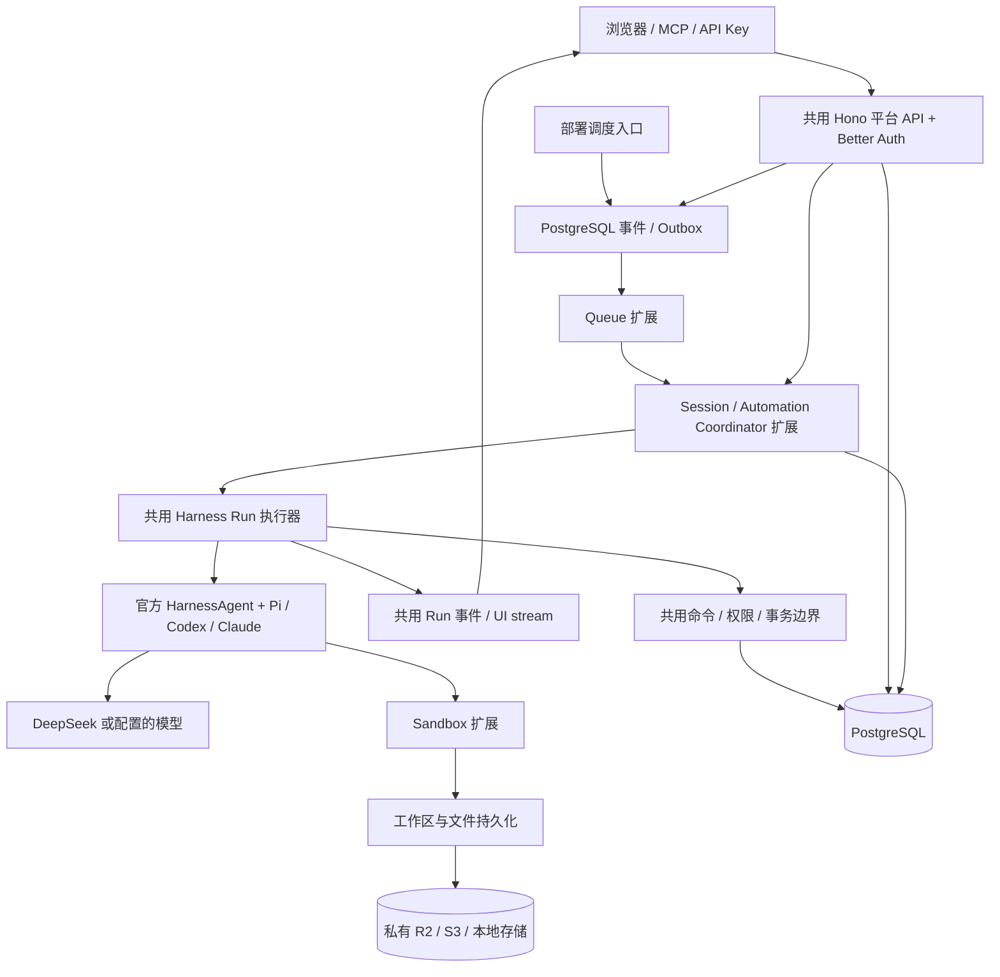

# tabdo 双部署模式架构

日期：2026-10-14。**目标架构已确定，部署支持状态以文末验收记录为准，不能把设计当作已经上线。**

用户要求：现代、TypeScript、edge-friendly、有独立核心 framework 和可扩展适配包；传统 Node/Redis 与 Cloudflare 两种部署；tabdo 产品和用户对模式无感知；保留 Better Auth 与官方 Harness SDK。参考[Pars 核心层调研](pars-review.md)。

## 1. 关键决策

- 同一套平台业务、身份、数据契约、Run/Session 和对外 API；部署入口负责组装扩展。
- **触发、协调、执行分离。** 定时、自动化和聊天都是 Run 来源；纯数据动作不启动 Sandbox。
- 完整 Harness 执行器运行于兼容的 Node 环境，可嵌入传统服务，也可按需启动独立执行环境。Cloudflare 入口不导入宿主 Pi 的 Node-only 模型运行库。
- 核心不探测运行时、不读取 process.env、不维护租户全局变量；使用 Web 标准和显式依赖。
- PostgreSQL 保存权威业务状态；DO / Node coordinator 管理执行和连接，不能形成第二套 Run 状态真相。
- 部署模式与 Sandbox 供应商是两个正交选择。Cloudflare 模式不要求换 Harness，也不要求固定使用 Cloudflare Sandbox。
- API URL、HTTP 状态、AI SDK UI stream、数据库格式和错误语义保持一致。客户端不接收部署模式字段，不选择 provider，不因部署模式迁移聊天界面。

## 2. 逻辑分层

## 3. 包组织与依赖方向

| 包 | 职责 | 依赖约束 |
| --- | --- | --- |
| `@tabdo/core` | 运行上下文、错误、provider contracts、deployment manifest、service/transport 与能力验证 | Web 标准；不依赖 Hono、Better Auth、数据库、Node、Cloudflare 或具体模型 |
| `@tabdo/platform` | Hono app factory、Better Auth、组织权限、命令、数据 schema、Run/Session repository、触发匹配与 outbox | 依赖 core/shared 和 PostgreSQL 语义；不依赖某个部署扩展 |
| `@tabdo/agent-runtime` | 官方 Harness 组装、Skill、工具、原生恢复、执行事件与终态保存 | 依赖平台服务 contract 与 SDK；Node-compatible 的执行侧包，不进入 edge API bundle |
| `@tabdo/runtime-node` | Node 入口、BullMQ、后台 relay、协调/事件 transport、本地执行器 | 依赖 core；按入口选择平台与执行侧包 |
| `@tabdo/runtime-cloudflare` | Worker 入口、Queues、DO 协调、Cron/Alarm、Hyperdrive/R2 binding、按需执行器 gateway | 依赖 core；使用官方生成的 Workers 类型，不包含 BullMQ 和宿主 Pi |
| `@tabdo/sandbox-*` | local / Vercel / E2B / Cloudflare 的创建、查找、暂停、恢复和清理 | 遵循官方 Harness sandbox contract；平台通过明确能力选择，不提供成功假实现 |
| `@tabdo/shared` / `@tabdo/ui` | 产品 API、Zod schema、前端与 UI | 保持原作用；不依赖部署扩展 |

`apps/server`、Cloudflare app 和执行镜像只负责 composition。子路径导出保证只加载所选适配器。尚未有独立职责的代码不为了包数量硬拆。上述包是目标边界；实施中允许逐个迁移并保留短期兼容入口。

## 4. 两种部署的映射

| 能力 | A：传统模式 | B：Cloudflare 模式 |
| --- | --- | --- |
| 公共 HTTP / 聊天协议 | Hono + Node server | 相同 Hono app + Workers |
| 身份与用户 Key | Better Auth + PostgreSQL | 同一身份模块；绑定配置按请求注入 |
| 事件投递 | BullMQ / Redis | Cloudflare Queues |
| Session 协调 | Node 扩展 + PostgreSQL fence | 每个 Session 一个 DO + 同一 PostgreSQL fence |
| 定时入口 | 后台 due-schedule 扫描 | Cron 唤醒同一 due-schedule 服务；必要时 Alarm 提高唤醒精度 |
| 完整 Harness 执行 | 同进程 / 独立 Node 执行进程 / 远程按需环境 | 按 Run 启动 Node-compatible 执行环境；不是在 queue handler 中等待完整模型循环 |
| PostgreSQL 连接 | 官方 Postgres.js 连接池 | 官方 Postgres.js + Hyperdrive，请求作用域连接和关闭 |
| 文件对象 | local / S3-compatible（含 R2） | R2 binding 或相同 S3-compatible provider |
| 实时呈现 | AI SDK UI SSE，按数据库 Run 恢复 | 相同 SSE 公共协议，DO 内部桥接/广播；不强迫 UI 改为另一套 SDK |

两种模式共享 callback、错误、状态、取消和恢复语义。DO 可以保存 alarm、订阅游标等可重建的协调元信息；不复制业务数据作为权威来源，也不能把所有会话集中到一个 DO。

## 5. 三种入口与 Session / Run

- Chat：身份与上下文校验，持久创建 Run，立即请求 coordinator 调度，并订阅同一 Run 的输出。断开浏览器只断开订阅，不等于取消。
- 定时：同规则版本与计划时刻只创建一个 occurrence；沿用 IANA 时区、停机合并语义及独立 scheduled_task 会话类型。
- 数据自动化：业务修改、触发快照、动作计划和 outbox 同事务提交。数据动作执行共用命令，run_agent 动作关联稳定 Run / 私有 Session。

Session 是长期上下文；Run 是一次输入或未完成 turn 的续接；Sandbox 是计算环境。新消息可以启动新 Run 并恢复相同 Session；问题回答继续原 Run。一个 Session 最多一个活跃执行者，不同 Session 可并发。

## 6. 最小 provider contract

- **QueuePublisher**：发布带 protocol、稳定 deliveryId / eventId、generation 的 envelope；不承诺供应商 dedup、priority 或 getJob。
- **Delivery**：attempt、ack、retry / dead-letter；push / pull consumer 由扩展实现，业务不启动供应商消费循环。
- **Coordinator**：持久接受 start / resume / cancel 请求，发现已有 Run 则返回同一执行身份；订阅输出属于独立 transport。
- **ExecutionProvider**：按稳定执行 ID 启动/查找运行，保存可恢复环境引用，暂停/恢复/释放；宣告实际能力。
- **RunRepository**：创建、fence 领取、活动/检查点、取消、待答、终态和关联来源；PostgreSQL 实现是两模式的权威实现。
- **ObjectStorage**：对象 put/open/remove；租户与字段权限、元信息和生命周期属于平台。
- **Identity**：由 Better Auth / 用户 Key 产生 principal；不相信前端/队列里的 organizationId 与 userId 直接成为授权。

优先复用 SDK sandbox 类型，避免再定义一套文件/进程接口。运行服务使用 typed request/response envelope，直接嵌入与内部 RPC 行为一致；仅跨进程需要的调用使用 transport。

## 7. 可靠投递与执行

PostgreSQL 与队列不能组成一个跨服务事务。relay 先原子领取 outbox，事务提交后发布，再按领取 token 确认。发布成功但确认失败可能重复投递，两模式均依赖数据库效果凭据与 fence 去重。

Queue consumer 的完成含义是“执行请求已持久接受”，不是“智能体已经跑完”。长任务由执行 provider 与 coordinator 持久管理，不能用 Worker waitUntil 或 queue/cron handler 的存活保证无限执行。Queue / Cron / Alarm 当前有 15 分钟 wall-time 边界，不能成为隐藏的智能体任务上限。

执行启动也必须幂等：以稳定 Run ID 查找已启动环境；供应商启动结果不明时进入核对状态，不能因为队列重试重新调用已经执行的工具。纯数据库修改与动作 receipt 在同事务提交；跨外部系统不承诺无条件 exactly-once。

租户/Session 并发控制由 coordinator 和 PostgreSQL guard 实现，Redis 锁不能是核心业务正确性的唯一来源。工具写入必须在重新校验当前成员资格和 fence 的同一事务内完成。

## 8. 待答、恢复与取消

数据库保存：原生 SDK resume state / continuation、工具调用 ID、已接受答案、Session 身份、Sandbox provider/引用、工作区快照引用和 stream cursor。不能存 JavaScript 对象句柄，也不能依赖进程 Map 正确恢复。

等待用户时先保存 continuation 和工作区，再暂停/释放计算；如果某 provider / adapter 不能无损恢复未完成 turn，明确标记能力不支持，不伪装待答已可释放。恢复只提交本次输入或答案，不从 UI 历史重放工具。

取消先持久化，再通知当前执行者；断开 SSE 不触发取消。最终消息、原生检查点和 Run 终态保持原子提交。任务实例结束不等于销毁用户的长期 Session。

## 9. Edge 和安全边界

应用配置为不可变值，request bindings / principal 使用显式请求上下文；不做全局 setEdgeEnv，不以 process 是否存在探测 Cloudflare。不保留跨请求的数据库 socket；Hyperdrive 查询缓存不能用于成员资格、租约和关键状态判断。

完整宿主 Pi 是 Node in-process runtime，移入执行侧包；Worker 不以 polyfill 掩盖 SDK 能力差异。Sandbox 字节文件、用户上传文件和平台数据库凭证分开；不把数据库管理员密钥交给不受信任脚本。内部服务请求必须有有限期的执行身份、完整资源范围和 fence，所有工具执行仍复核权限。

密钥、provider 名称、容器 ID 和部署模式不进入普通用户界面、公开 Run 投影或客户端配置。

## 10. 配置和切换

部署入口明确选择 `node` 或 `cloudflare`；manifest 组合 queue / coordinator / executor / storage。启动时验证所需 binding 与能力，不允许未知 provider 静默回落。

切换模式保持 PostgreSQL、对象位置、Session 身份和 API schema；发布时停止接收新执行、保存或核对在途任务，再启用新部署。部署模式切换与 Sandbox provider 切换不是同一件事，不能承诺任意供应商的活跃内存状态可直接热迁移。

客户端和 tabdo 业务服务不包含 `if cloudflare` / `if node`；所有差异只出现在 composition 和扩展包。传统部署是持续支持的正式模式，不是将被删除的临时兼容层。

## 11. 调研结论与当前平台接口

- 官方 HarnessAgent 区分 host-runtime Pi 与 bridge-backed Codex/Claude。保留此边界，不把网络 Sandbox 等同完整 Pi 控制进程已迁移。
- E2B 已提供 `@e2b/ai-sdk-sandbox`，当前为实验包，需核对与锁定的 AI SDK 7 版本的 compatibility。
- Cloudflare PiHarness 使用 Pi Durable，当前 Beta；它是另一套适配，不作为本次双部署默认替换。
- Cloudflare Sandbox 当前 1.x 是 DO container helper，生命周期由 ctx.container 管理；旧 0.x getSandbox 模式不能直接当作当前 API。使用匹配的官方类型、CLI schema 与镜像版本。
- Wrangler 4.149.0 本地可运行；现有登录已过期，远程创建/部署/验收尚不可进行。本地构建与验证不受此登录影响。

## 12. 实施顺序与验收

先落 core contracts / 显式 composition；再把现有 Node 模式接入，证明无产品行为改变；然后实现 Cloudflare 扩展及独立执行入口。最后增加受控 Sandbox provider，并验证跨进程问题续接。每步单独提交，已有测试与新增跨模式 contract tests 同时约束行为。

共同验收必须覆盖：

1. 相同 Cookie / API Key 身份、工作区隔离、响应和 AI SDK UI stream。
2. 普通聊天、定时任务、自动化 run_agent、纯数据动作及对应批量操作。
3. 两个 Run 恢复同一 Session；问题回答跨实例续接且已完成工具不重放。
4. 重复投递、启动 ACK 丢失、消费重试、进程退出/DO 重建、发布期间保存。
5. 用户取消与浏览器断线分离，实时撤销成员资格，fence 防止旧执行者写入。
6. 两模式共用文件元信息与实际对象、同一 Skill、原生历史和来源类型。
7. Workers bundle 不包含 Node-only agent runtime / BullMQ；扩展未安装时核心可独立构建。
8. 两个部署入口真实调用同一业务与 Harness 测试夹具；只构建成功不算完整 Cloudflare 验收。

### 实施记录

- [x] 读取现有 Chat / Automation / Schedule / Run / Session / Outbox 调用链。
- [x] 阅读 Pars 核心、service、queue、storage、realtime 源码，形成借鉴与差异记录。
- [x] 核对官方 Cloudflare / SDK 当前接口与执行边界，检查本地 CLI。
- [x] 确定本架构与模式无感知的公共契约。
- [x] 第一批 core / runtime-node / runtime-cloudflare 包落地：共同队列与字节存储契约；传统 Outbox 显式注入 publisher，本地/S3 使用 Node 扩展。
- [x] Cloudflare Queues / R2 扩展在真实本地 workerd 验证；失败接受重试、二进制读写、对象路径校验通过，dry-run bundle 不含 Node-only 依赖。
- [x] 传统队列 18 项故障测试（包含注入非 BullMQ publisher 的 SQL 领取/失败/重试用例）、文件本地/S3 3 项、官方 Pi 跨进程待答恢复测试通过；全仓源码与测试类型检查通过。
- [ ] 共同平台 app / 请求资源与 Better Auth factory；typed service、Run repository 和执行侧包提取。
- [ ] Cloudflare 入口、投递/协调/执行扩展与本地真实验证。
- [ ] Sandbox 供应商扩展及跨实例恢复验证。
- [ ] 有真实凭证后的远程部署验收。

当前实际包 API 见 [core](../../packages/core/README.md)、[Node](../../packages/runtime-node/README.md)、[Cloudflare](../../packages/runtime-cloudflare/README.md)。Node 生产镜像与本地开发构建已包含新的工作区依赖。CF Worker 目前只有隔离测试 fixture；不是完整平台部署。固定 Wrangler 本地二进制最高支持 `2026-10-13`，fixture 使用这个 compatibility date，bindings 由 CLI 生成。

## 13. 官方依据

- [HarnessAgent](https://ai-sdk.dev/docs/ai-sdk-harnesses/harness-agent)、[Harness adapters](https://ai-sdk.dev/docs/ai-sdk-harnesses/harness-adapters)
- [SDK Sandbox contract](https://github.com/vercel/ai/blob/main/architecture/sandbox-abstraction.md)、[E2B adapter](https://github.com/e2b-dev/ai-sdk-sandbox)
- [Cloudflare PiHarness](https://developers.cloudflare.com/agents/harnesses/pi/)
- [Workers best practices](https://developers.cloudflare.com/workers/best-practices/workers-best-practices/)
- [Queues API](https://developers.cloudflare.com/queues/configuration/javascript-apis/)、[execution limits](https://developers.cloudflare.com/queues/platform/limits/)
- [Hyperdrive / Postgres.js](https://developers.cloudflare.com/hyperdrive/examples/connect-to-postgres/postgres-drivers-and-libraries/postgres-js/)
- [Sandbox 1.x](https://developers.cloudflare.com/sandbox/reference/)、[Container API](https://developers.cloudflare.com/containers/api/)
- [DO pricing](https://developers.cloudflare.com/durable-objects/platform/pricing/)、[Containers pricing](https://developers.cloudflare.com/containers/platform/pricing/)
