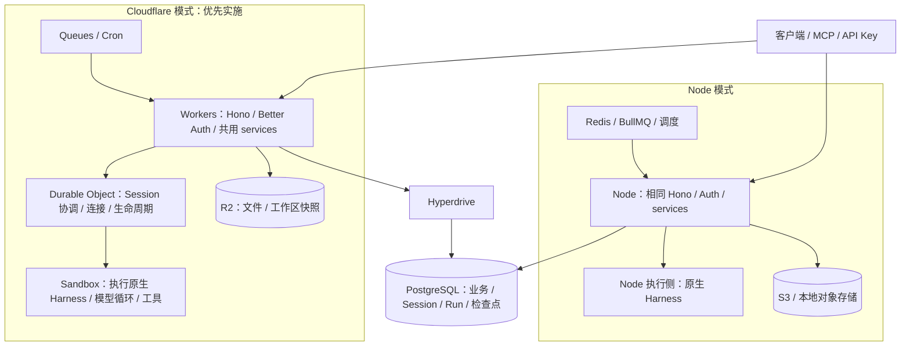

# tabdo 双部署模式架构

日期：2026-10-14。本文与[运行时与包边界](runtime-boundaries.md)共同作为当前实施依据。**Cloudflare 优先，继续支持 Node 双部署；Cloudflare 使用 Workers + DO + Sandbox，在 Sandbox 内执行原生 Harness，不额外要求常驻 Node API 服务。** 平台实现按 Node/Cloudflare 分包，共用业务通过显式依赖注入。下面的目标尚未全部实现，第 11 节只记录已有验证。参考 [Pars 核心层调研](pars-review.md)。

## 1. 目标与不可变边界

支持传统 Node + Redis 和 Cloudflare 两种模式，用户、客户端、MCP 和 Tabdo 业务无感知。共用产品 API、Better Auth、权限、PostgreSQL 业务数据、原生 Session/Run、Skill 和聊天协议。

底层框架使用 TypeScript、Web 标准与显式依赖。**基础设施包不依赖产品业务**，不读取全局环境，不探测运行时，不维护跨请求 principal。保留官方 HarnessAgent 和原生模型/工具循环。PostgreSQL、Drizzle 与 Better Auth 保留；不改成 D1。

能力、供应商、部署模式是三个不同维度：queue 是能力，BullMQ/Cloudflare Queues 是实现，Node/Cloudflare 是装配方式。Sandbox 供应商与部署模式也独立。

## 2. 部署拓扑



这是部署调用图，不是包 import 图。Cloudflare 的 Node 执行环境位于 Sandbox 内，没有额外常驻 Node 服务作为前置条件。Workers 与 Node API 分别装配同一套 services；共用业务包不是隐藏的远程 Node 后端。DO 管协调，Sandbox 内的官方 Harness 管模型与工具循环。

## 3. 包职责与目录

| 包 / 入口 | 拥有的内容 | 不拥有的内容 |
| --- | --- | --- |
| `@tabdo/core` | 通用 Queue/Storage/Execution/Harness 端口、Web 控制协议；按能力分模块 | 产品业务、数据库 schema、Node/Cloudflare SDK、混合运行时类型 |
| `@tabdo/platform-node` | BullMQ/Redis、local/S3、数据库连接、进程执行、原生 Node Harness/Sandbox 适配；执行子模块也供 CF Sandbox 镜像使用 | 产品权限、自动化、Run 业务状态与 CF binding |
| `@tabdo/platform-cloudflare` | Queues、R2、Hyperdrive 连接、DO/Alarm、Sandbox 控制与生命周期 | 产品 SQL/schema、原生 Node Harness SDK、第二套模型循环 |
| `@tabdo/backend` | Hono app factory、Better Auth、业务 services/命令/权限、PG repository、事件/Outbox、Run/Session 服务 | Node serve、Wrangler binding 配置、隐式 DB/Auth scope、供应商消费循环 |
| `@tabdo/agent-runtime` | Tabdo 人设/Skill/工具与执行上下文装配，聊天/自动化/定时共用执行与检查点保存 | 再实现一套 SDK 原生工具、计划、目标或 read_skill |
| `@tabdo/shared` / `@tabdo/ui` | 产品 API/Zod schema、业务消息协议、客户端类型与 UI | 部署模式选择和适配器装配 |
| `apps/server` / `apps/cloudflare` / Sandbox 镜像入口 | 配置解析、能力组合、绑定、HTTP/后台启动与执行生命周期；Worker 与镜像分别构建 | 另一套产品业务实现、CF 必须另外部署的常驻 Node 服务 |

不为目录齐全预先造空包。新 core 只收已复用的纯能力契约，不恢复旧 core 的业务消息/文件 namespace。表格、组织、automation 等协议仍在 shared/backend。静态依赖为：backend → core/shared，agent-runtime → backend/core，两个 platform 实现 → core；应用装配连接业务与实现，backend 不反向 import agent-runtime 或 platform 实现。

```text
packages/core/src/{queue,storage,execution,harness,transport}
packages/backend/src/{services,repositories,auth,schema,http}
packages/agent-runtime/src/{preparation,tools,skills,projection}
packages/platform-node/src/{queue,storage,database,execution,harness,sandbox}
packages/platform-cloudflare/src/{queue,storage,database,coordination,execution,sandbox}
apps/cloudflare/src/{http,queue,scheduled,composition,session-object}.ts
apps/cloudflare/sandbox/    # 镜像与内部 Harness 执行入口，不是独立公共服务
apps/server/               # Node 模式装配
```

两个实现包独立 dependencies/exports/tsconfig/测试。Worker 只静态引用 platform-cloudflare；Sandbox 内的执行入口引用 platform-node 的 Harness/执行子模块，不加载 BullMQ/Redis。禁止运行时检测和双平台 barrel。Worker 由 Wrangler 打包 TypeScript，镜像有独立执行侧构建；镜像入口无需单独公网域名或常驻 Node API。

原 `packages/platform` 已改名 backend，schema/Auth/checkpoints 保持单一来源，首批身份服务改为显式 DB/session resolver 注入；旧资源 scope 暂支持尚未迁移的应用调用。core/platform-node/platform-cloudflare 已物理分离，原混合能力包移除；业务命令、Run repository、平台连接实现和 agent-runtime 仍需继续按上述目标提取。

## 4. 通用契约与业务边界

### Queue

```ts
type QueueMessage<T> = Readonly<{ id: string; body: T }>;
interface QueuePublisher<T> {
  publish(message: QueueMessage<T>): Promise<void>;
  close?(): Promise<void>;
}
```

通用包只验证 envelope，消费 callback 收到不可信 payload，由业务 handler 解析。稳定 id 由调用者生成；CF provider message ID 与应用 id 分开。不把供应商 ACK 当业务去重保证，不承诺跨供应商优先级、getJob 或 exactly-once。

Tabdo 的 `{protocol, eventId, generation}` 在 `shared` 业务契约中。平台 relay 校验 payload、生成 `automation-<eventId>-<generation>`，再调用 `publisher.publish({id, body})`。BullMQ 队列名与任务名在应用入口配置，底层工厂叫 `createBullMQPublisher`，不叫 `createAutomationQueue`。

供应商消费循环留在对应 platform 实现。ACK 表示 callback 成功；**本平台 callback 必须在持久接受执行后返回**，不把完整 agent turn 塞进 CF queue handler。如果在 PG 接受后、DO 启动前 ACK，必须同时持久化待派发记录并有补偿唤醒。显式 ack/retry，重试与 DLQ 在 Wrangler 配置中声明。

### Storage

公用接口只有 put/open/remove。支持普通相对对象 key，例如 `reports/weekly.txt`；底层不能强制 Tabdo 的 `<UUID前两位>/<UUID>`。本地适配器必须阻止绝对路径、路径穿越及非法分隔符。字段归属、UUID namespace、25MB 等上传限制在平台层执行，两种部署共用。

S3 和 R2 都是私有字节后端；不为直接访问 bucket 绕过平台权限。数据库存文件元信息与逻辑位置，旧对象读取配置必须可追溯。统一接口不代表所有供应商都支持相同的条件写入或热迁移能力。

### Harness、Sandbox 与 Execution

Harness 管理原生模型/工具循环和 Session continuation；Sandbox 提供文件、命令与网络环境；Execution 启动**承载完整 Harness 控制进程**的计算资源。三者分别装配，不能把“更换文件/命令 Sandbox”当作“Pi 模型循环已经迁到云端”。

复用官方 SDK 的 sandbox 类型，不造另一套同义文件 API。Tabdo agent-runtime 负责把产品配置和业务工具注入官方运行器。底层适配器接受显式配置/回调，不读取 organization/member/automation 表。

原生执行与 HTTP 响应分离：`executeNativeRun` 接收已接受的 Run、lease、原生检查点和产品工具，等待 SDK 输出消费、检查点提交及资源清理完成。可选输出端口使用现有 AI SDK UI chunk；HTTP 层只投影这些 chunk。浏览器取消订阅不取消执行；显式停止通过 PG Run cancel 字段控制。此入口属于 agent-runtime，不放进 core。Cloudflare 在 Sandbox 内调用它，Node 模式可嵌入或独立进程调用；跨进程从持久执行引用重新装配，不传工具闭包，不凭内存 Promise 确认启动。

## 5. 两种部署的组合

| 能力 | A：Node | B：Cloudflare |
| --- | --- | --- |
| 产品 HTTP 与身份 | 共同 Hono app + Better Auth，Node serve | 同一 app/auth factory，Worker bindings 按请求注入 |
| Queue | `platform-node/queue`：BullMQ | `platform-cloudflare/queue`：Queues |
| Storage | `platform-node/storage`：local/S3 | `platform-cloudflare/storage`：R2 |
| 数据库 | Postgres.js pool | Postgres.js + Hyperdrive，请求作用域连接和关闭 |
| 调度唤醒 | 后台 due-schedule 扫描 | Cron/必要的 Alarm 唤醒相同业务调度函数 |
| 协调 | Node 生命周期 + PG fence | 每 Session 一个 DO + 同一 PG fence |
| 完整智能体执行 | 嵌入或独立进程，执行原生 Harness | DO 管理按需 Sandbox，在其内部执行同一原生 Harness |
| 聊天输出 | 公共 AI SDK UI SSE | 相同公共 SSE，DO 内部桥接，不更换客户端协议 |

部署入口拥有供应商名和绑定配置；业务服务只获得契约。CF 优先接 Cloudflare Sandbox，不强制切换 Pi Durable；E2B/Vercel 是可选后续适配，不是首条 CF 路线前置条件。共享代码必须在真实 Worker 中运行，不能靠 CF 代理整个常驻 Node API 宣称两模式实现完毕。

## 6. Run、Session 与事件可靠性

Session 是长期原生上下文，Run 是一次输入或未完成 turn 的续接。新消息创建新 Run 并恢复同一 Session；回答问题继续原 Run。一个 Session 同时最多一个执行者，不同 Session 可并发。

聊天、定时、数据自动化共用 Tabdo Run 服务。定时保留 IANA 时区、版本/计划时刻唯一 occurrence、停机合并和独立 scheduled_task 会话类型。纯数据动作不启动 Sandbox。

业务修改、触发快照、动作计划与 Outbox 同一 PG 事务。Relay 领取 token/fence 后提交事务，再投递并确认；确认失败可能重复投递。业务 receipt、当前 generation 与 fence 共同保证已提交修改不重放，这些规则属于平台，不进入 queue 包。

队列持久接受后，执行器与协调层管理长任务。CF queue/cron/alarm 的 wall-time 边界不能成为 agent 的隐含执行上限。启动 ACK 不明时按稳定执行身份核对，不重新调用已执行工具。

PG 是 Run/Session/权限的权威来源。DO 仅保存可重建协调信息、订阅游标或 alarm；不建第二份业务状态，不集中全部 Session。Redis 并发锁只是供应商协调实现；业务正确性仍由 PG fence 保证。

## 7. 恢复、取消与权限

保存原生 resume state、未完成工具调用 ID、已接受答案、环境引用、工作区快照和 stream cursor。生产恢复不能依赖进程 Map 中的活对象。先保存 continuation/工作区，再按供应商真实能力暂停或释放；不支持的能力明确失败。

恢复提交本次输入/答案，不从 UI 历史重放工具。取消先持久化再通知执行者；浏览器断开只断开订阅。最终消息、检查点、Run 终态原子提交。

Better Auth/用户 API Key 产生实际 principal。队列 body、URL 和内部 RPC 中的用户/组织 ID 不能直接成为身份。每次工具写入仍在同一事务中复核当前成员资格、资源范围与 lease fence。

## 8. Edge、内部服务与配置

配置不可变，请求资源显式注入；不用全局 setEdgeEnv 或 process 是否存在检测部署。Workers bundle 不加载 Node-only 模块，不共享请求间 socket；Hyperdrive 查询缓存不能影响权限、租约和关键状态判断。

内部调用可使用同一 typed service contract 的 embedded/HTTP/binding transport，仅跨进程确有需要时使用 RPC。工具 gateway 使用有限期执行身份和 fence，不向不受信任脚本交付 DB 管理密钥。

平台工厂必须先在真实 workerd 中验证：使用本地 Hyperdrive binding 连接隔离 PG，每请求创建/关闭 DB resource，复用 Better Auth factory 检查注册、签名和并发配置隔离。该 fixture 只验工厂，不把仍含全局依赖的产品 app 当作可部署 Worker。Hyperdrive 使用 Postgres.js 默认 `prepare: true`；官方已明确不推荐在其事务池中设 `prepare: false`。本地 binding 不模拟远程连接池/缓存，权限与 fence 路径仍需远程关闭查询缓存后验收。

供应商核对（2026-10-14）：E2B `@e2b/ai-sdk-sandbox` 0.3.0 仍提供被当前 Harness 标记废弃的 `HarnessV1SandboxProvider`；创建用 session metadata 标识、恢复按此 metadata 查找，物理 sandbox ID 与平台逻辑 ID 不相同，不能直接改名接入。它是后续可选适配。CF 首条路线使用当前 Sandbox/DO container API，并分别验证完整 Harness 执行与文件/命令环境；不沿用 0.x 生命周期示例。

本地 CF 优先使用 Wrangler，Hyperdrive 的本地连接指向现有 PostgreSQL；业务模型与迁移继续使用 PG/Drizzle。回归只使用 `_agent_test` 隔离库。Docker 支持本地 Sandbox 容器验证；线上 Hyperdrive 池/缓存、容器冷启动及恢复仍须远程验收。详细本地边界见[运行时与包边界](runtime-boundaries.md)。

部署模式、供应商 ID、容器 ID 和密钥不进入公开 API 或普通 UI。部署切换保留数据库/对象位置/Session 身份和 API schema，先停止新执行并保存/核对在途任务；不承诺任意供应商活跃内存热迁移。

## 9. 实施顺序

1. **纠正文档与边界。** 明确五个后端包、CF 控制侧/Sandbox 执行侧、PG 权威状态与双部署目标。
2. **CF 本地基线。** 使用 Wrangler、现有 PG 隔离库和 Docker，验证 Hono/Auth、DO、Queues/R2 与完整原生 Harness 的 Sandbox 生命周期；不替换 Harness。
3. **物理包隔离。** core 收纯契约，Node/CF 实现分别迁移到对应 platform 包；改各自 exports、类型、依赖、Worker 与镜像构建，保留现有 Node 回归。
4. **共用业务显式依赖。** schema/Auth/services/repositories 提取到 backend，清除隐式 DB/Auth/env；agent-runtime 装配复用原生 SDK 工具与恢复，不另建常驻 Node 服务。
5. **统一触发与派发。** 聊天、定时、自动化调用相同接受服务；CF Queue/Cron/DO 接通 Outbox、Sandbox 启动与补偿，保持权限/receipt/fence 保护。
6. **真实双模式验收。** 本地完成，再做远程 Hyperdrive/Sandbox 验收；客户端、MCP 与聊天协议保持一致。

每阶段单独提交。移动文件不算完成解耦；底层包能处理非 Tabdo 消息和普通对象 key，业务测试行为不变，才算第一阶段完成。

### 此前并行实施记录（2026-10-14）

用户已要求 agent team 并行实施。三条线分别负责平台请求依赖、独立执行器、CF 协调/触发；公共接口、迁移和最终接线由主代理汇总。平台资源使用显式作用域，禁止跨请求修改共享 DB/Auth；runner 只接收持久 Run/执行引用，从 PG 重建权限、输入与检查点，不接收工具闭包。通用 execution 包只管理计算资源，不拥有产品 Run 状态。CF 协调与队列入口接收注入的持久服务，不能靠空成功回调或代理常驻 Node API 宣称完成。

各线独立提交前必须完成相应真实用例；共用构建、安装、锁文件、数据库迁移及全仓回归统一执行，避免并行清理 dist 导致虚假失败。验收区分通用能力、产品接线、本地 workerd/跨进程证明和远程部署，不提前勾选完整双模式完成。

## 10. 验收要求

- core 与两个 platform 实现不含 automation/table/user/org 协议，不依赖 backend/shared/schema；平台包 dependencies 与运行时类型隔离，services 通过参数取依赖。
- Worker 制品不包含 Node Harness/BullMQ/宿主文件模块；Sandbox 镜像仅加载执行侧代码，不要求独立常驻 Node API。Wrangler 直接打包 Worker 源码，镜像单独构建。
- 通用非业务消息、普通对象 key 在适配器中真实运行；Envelope 校验与业务 payload 校验有独立测试。
- 相同 Cookie/API Key、工作区隔离、HTTP 状态与 AI SDK UI stream；聊天、定时、自动化 run_agent 和数据动作共用业务实现。
- 重复投递、确认丢失、重试、消费接管、DO 重建与进程退出；已提交工具/数据不重放。
- 原生 Session 跨 Run 恢复，Sandbox 释放/恢复和问题回答跨实例续接；取消与断线分离，权限撤销和 fence 防止旧执行者写入。
- 两模式共用文件元信息、实际对象、Skill、历史和会话来源。构建成功不等于完整平台部署验收。

## 11. 实施记录

### 当前平台分包与 CF 本地门槛

- [x] core 纯契约/签名 Web transport，Node 与 CF 实现独立包；原 queue/storage/execution/harness/sandbox 混合包移除，应用、测试、锁文件与 Node Docker 构建更新。
- [x] CF DO 框架不绑定产品 Run/Thread 字段或 AI 协议，任意引用/输出由应用注入；真实通用 DO 重建、R2 archive、凭证撤销和取消验收。
- [x] backend 名称与身份服务显式依赖；真实 PG/Better Auth 不使用 ALS 的身份、角色、撤销与事务成员列表验收。命令、Run/Session、问题接受、due-schedule 与 Outbox 已继续迁移；报告、集成与执行装配仍待提取。
- [x] 真实 Wrangler → DO → Docker → 原生 Harness/Pi：工具执行、待答 detach、销毁容器、新容器读取 checkpoint 回答原问题，工具不重放。镜像独立锁文件、无真实模型费用、无遗留测试容器。
- [ ] 产品 PG 持久接受/派发 → DO/Sandbox → 工具 gateway → 检查点与输出全链路；自动化/定时接同一服务。
- [ ] 全部共用 services/业务 repositories 与 agent-runtime 提取；完整产品 Worker 和双部署本地验收。

本批证据：149 项 server 回归、2 项 core、9 项 Node 实现、2 项 CF Queue/R2、1 项通用 DO、4 项产品 PG/DO、1 项 CF PG/Auth 工厂和 1 项真实 Sandbox 冷恢复通过。全仓 build、源/测试类型检查、静态架构边界、冻结离线安装及 CF dry-run 通过。Sandbox 用例是能力验收，DO 中保存的 checkpoint 只用于夹具传输；产品 PG/R2 权威状态未被替换。详见[Sandbox 验收](../../apps/cloudflare/sandbox/README.md)。

### 2026-10-15 共享业务服务

- [x] 所有表格命令、tenant、文件引用、自动化 CRUD/事件/调度、Outbox relay 显式依赖；移除命令 registry 的循环依赖，调用方事务全程复用。
- [x] Run/Session、lease/fence、原生检查点、execution 接受/输出、问题回答单一 backend 实现；保留 SDK 原生 schema 验证。
- [x] backend 移除 Node ALS/resources 和 Node ambient types，Node app 留薄兼容装配；架构检查禁止 runtime/global/HTTP 混入业务服务。
- [x] 真实 Workers + PG/Better Auth/DO 直接调用 backend：共享 Hono 命令、batch 写入/回滚、scope/membership、私有输出与取消。
- [x] 通用 DO/Sandbox ExecutionAdapter：持久 launch fence、提前 spawn ACK、懒 completion、冷实例显式 probe/unknown、不盲重播与取消竞态；真实 Wrangler/Docker 框架验收。
- [ ] 完整 Worker HTTP/Queue/Cron + agent-runtime + Sandbox gateway；自动化/定时接同一 durable acceptance。

### 此前阶段记录（保留原验证范围）

- [x] Pars 与现有运行链路调研；第一版发布/存储抽取通过 Node 和 workerd 测试。
- [x] 架构修订：按能力包 + 包内 adapters，补充基础设施与业务解耦边界、依赖图和新实施顺序。
- [x] 按修订迁移 queue/storage 与包内 adapters；业务消息协议移至 shared、文件 namespace 留在 server；移除旧 core/runtime 包，更新 exports、optional peers、开发构建、Docker 与回归。
- [x] 第一批平台工厂：HTTP app 与 Node 启停分离；Better Auth 和 PG resource 接收显式配置，当前 Node 入口已接入。
- [x] 第一批独立 platform 包：共同 DB/auth 工厂、schema 和私有 checkpoint 契约；Node/workerd 两个实际调用者及兼容导出已接入。
- [x] 严格请求/任务 DB/Auth scope，Node HTTP、worker、CLI 和测试接入，无可变默认资源。
- [ ] 业务命令/Run repository 与 Hono 服务继续进入共同 platform 包；完整产品 HTTP 图去除 Node 环境、文件及执行侧依赖。
- [x] Harness/Sandbox 能力包：Pi/Codex/Claude SDK 配置与 local/Vercel 生命周期进入包内 adapters；Tabdo 环境解析、人设、业务工具、权限、工作区 schema 与限额继续留在平台装配层。
- [x] 平台嵌入式 Run 执行与 HTTP 投影分离；后台直接等待相同执行入口和检查点清理，关闭输出订阅不取消 Run。
- [x] 独立可信 runner：持久接受/输出、Node 子进程和签名 HTTP；真实 Pi 跨进程问题续接及重复启动不重放。
- [x] Node 聊天可选独立进程执行，公共请求与输出协议一致；已接受的启动失败可补偿。
- [ ] 自动化/定时统一接入接受服务；CF Containers/E2B 计算生命周期与其他 Harness 的远程恢复验收。
- [x] CF DO 输出/取消协调接通真实平台身份、私有输出和成员锁保护的取消。
- [ ] CF Queue/Cron 接通实际 Outbox、due-schedule 和执行接受/启动；完整产品 Worker 与按需计算装配。
- [ ] 完整双模式本地与远程验收。

本阶段验证：queue/storage 6 项通用用例（真实 BullMQ、workerd Queues/R2）、shared 11 项业务契约、server 18 项队列故障与 3 项文件存储用例通过。全仓 build、typecheck、typecheck:test、冻结锁文件安装与两份 fixture dry-run 通过；CF bundle 不包含 Node/BullMQ/AWS/业务协议。

当前落地包见 [queue](../../packages/core/README.md) 与 [storage](../../packages/core/README.md)。通用队列/存储、平台资源作用域、独立 runner 和 DO 输出/取消服务已实现；实际 CF 触发与完整产品 Worker 仍按清单待实施，不代表整个 CF 平台已可部署。Wrangler 4.149.0 本地可运行；既有登录已过期，远程验收需恢复登录。本地 fixture 按固定二进制支持的 `2026-10-13` compatibility date，并生成 binding 类型。

Harness/Sandbox 实现见 [harness](../../packages/platform-node/README.md)、[sandbox](../../packages/platform-node/README.md)。独立通用用例 3 项和平台 Harness 回归 41 项通过，包括真正退出生产进程后的待答冷恢复。原生 SDK Pi 1.0.151 关闭 reattachInProcess 会改变待答捕获，保留官方默认不等于依赖应用 Map；平台的 warm-question Map 仍待执行器阶段替换。现有 local/Vercel adapter 已接入，CF/E2B 供应商的完整按需控制进程尚未实现，不以文件/命令 Sandbox 代替 Run runner。

平台工厂阶段：真实 Better Auth 注册/session 签名隔离、API Key 邀请与撤销、31 项聊天回归及源码/测试类型检查通过。app 仍引用现有 Node 业务图；尚未声明可进入 Workers bundle，后续先移除执行侧传递依赖与全局资源。

执行入口阶段：Harness 44 项、聊天 31 项回归通过。新增真实原生工具/PG 用例确认无输出端口的执行返回时最终消息、检查点与租约释放已完成；读流取消与关闭输出端口只断开投影，执行继续且下一轮不重放工具。该先行阶段仅有临时 UI 投影；持久 cursor 与独立 runner 已在下述并行阶段实现。

Edge 工厂阶段：workerd + 本地 Hyperdrive binding + 隔离 PG 的真实 Better Auth HTTP 验收通过，包含注册、8 个并发请求的签名配置隔离、退出登录、新请求观察撤销及每请求连接释放。只使用共用工厂与 schema，不加载 Node 启动/global DB/auth。远程 Hyperdrive 事务池/缓存和完整产品入口仍待验收。

platform 包阶段：上述实现进入 [platform](../../packages/backend/README.md)，Node 装配和 workerd 夹具直接调用包的公开 subpaths；server schema/factory 仅兼容导出。Drizzle 从原 schema 与兼容入口导出同样的 37 张表 DDL，无新增迁移。全仓 build/typecheck、冻结锁文件离线安装、141 项服务端回归与 workerd 工厂用例通过。全回归同时修复旧夹具缺少真实自动化创建者、空智能体动作及对字段唯一性旧错误的期待，没有放宽生产权限或唯一性校验。


并行执行阶段：新增通用 [execution](../../packages/core/README.md) 与 [CF 协调](../../apps/cloudflare/README.md)，产品接线见 [持久原生执行器](native-runner.md)。资源依赖不再通过默认 DB/Auth 导入；实际 workerd 同时验证 Better Auth 签名隔离、Cookie/API Key 身份和产品 agent admission。原生 SDK 只在执行装配时创建，SDK-free admission 可以独立调用。

新增迁移 `0026` 保存 private execution receipt 与单调 UI chunk cursor。接受时锁当前成员和 Run；调用 SDK 前先提交 invocation CAS。过期 `accepted` 可重绑新 fence，`invoking` 的未知状态不能作为重跑依据。真实 Node 子进程退出后，答案通过签名 HTTP 在新进程继续同一 Run，已提交工具不重放；两种 Node 聊天路径使用相同公共请求与 AI SDK UI SSE。持久 append 被等待、输出投影按需分页，浏览器断开不取消计算。

CF 真实服务 fixture 使用共享 `createPlatformSessionServices`：每个 callback 获得独立 DB/Auth resource，重新解析 Cookie/API Key，检查完整 execution/run/thread 引用，取消在当前 member 的 FOR SHARE 锁内提交。实际 bundle 不包含 Harness/Pi/Codex/Claude SDK、JustBash、Node startup/env 或文件执行模块。Queue/Cron generic fixture 仅证明端口和 ACK 边界；不能代替实际自动化/定时持久接受服务。当前 SSE 仍使 DO 活跃，hibernating WebSocket 内部桥接未实现。


验证结果：145 项服务端回归、18 项队列故障回归、4 项 execution 通用用例、4 项 CF 协调测试与 workerd 平台工厂测试通过。全仓 build、source/test 类型检查、冻结锁文件安装及两份协调 fixture dry-run 通过。故障回归发现迟到的 SDK activity 可覆盖 Run 终态，已增加终态保护，防止完成/失败后变回 running。

## 12. 调研依据

- [HarnessAgent](https://ai-sdk.dev/docs/ai-sdk-harnesses/harness-agent)、[Harness adapters](https://ai-sdk.dev/docs/ai-sdk-harnesses/harness-adapters)
- [SDK Sandbox contract](https://github.com/vercel/ai/blob/main/architecture/sandbox-abstraction.md)、[E2B adapter](https://github.com/e2b-dev/ai-sdk-sandbox)
- [Cloudflare PiHarness](https://developers.cloudflare.com/agents/harnesses/pi/)
- [Workers best practices](https://developers.cloudflare.com/workers/best-practices/workers-best-practices/)
- [Queues API](https://developers.cloudflare.com/queues/configuration/javascript-apis/)、[execution limits](https://developers.cloudflare.com/queues/platform/limits/)
- [Hyperdrive / Postgres.js](https://developers.cloudflare.com/hyperdrive/examples/connect-to-postgres/postgres-drivers-and-libraries/postgres-js/)
- [Sandbox 1.x](https://developers.cloudflare.com/sandbox/reference/)、[Container API](https://developers.cloudflare.com/containers/api/)
- [DO pricing](https://developers.cloudflare.com/durable-objects/platform/pricing/)、[Containers pricing](https://developers.cloudflare.com/containers/platform/pricing/)
