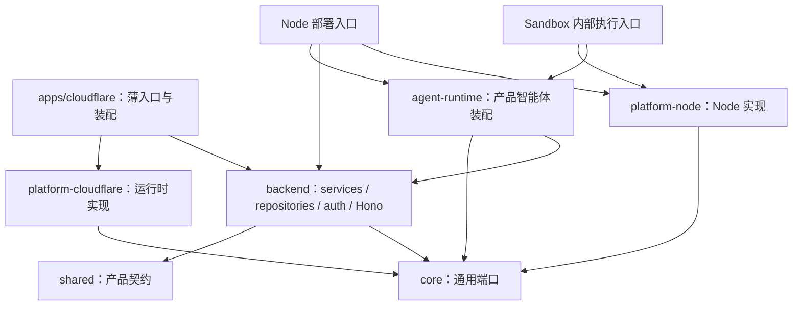

# tabdo 运行时与包边界

日期：2026-10-14。状态：平台包隔离与身份服务已实施，完整产品 CF 派发仍待接线。本文细化[双部署架构](dual-deployment.md)的包边界；Cloudflare 优先，本地使用 Wrangler、Docker 与现有 PostgreSQL 验证。Cloudflare 模式采用 Workers + Durable Object + Sandbox，不要求额外常驻 Node 服务。

## 1. 已确认的约束

**继续支持 Node 和 Cloudflare 两种生产部署模式，业务与用户无感知。** Cloudflare 模式的 API/触发入口运行在 Workers，DO 管协调与连接，按需 Sandbox 承载完整原生 Harness。Sandbox 内可以运行 Node、SDK 和命令行，不要求把现有 Harness 改写成 Workers 程序。

用户给出的 Edge 约束适用于 Workers/DO 与共用业务 services：TypeScript、显式依赖、Web API、Hono 薄入口、独立队列 handler、Wrangler 构建与生成类型。Cloudflare 本地入口优先 `wrangler dev`；Sandbox 镜像有独立构建与开发要求，不能把这一执行目标混入 Worker 编译图。

Node 模式使用常规 Node 服务与 Redis 队列，完整 Harness 可以嵌入或在独立进程执行。Cloudflare 模式使用 Queues/DO 管理任务，完整 Harness 在 Sandbox 内执行。两模式共用 services 与原生执行装配。此处执行入口只是加载官方 SDK 的程序，不是新增 Harness、额外常驻服务或独立部署模式。

客户端、API、身份和产品数据不暴露部署模式。兼容性不同的 Harness 不能伪装成同一实现，也不能承诺原生 checkpoint 跨 Harness 恢复。

## 2. 包按三个维度划分

| 维度 | 包 | 职责与限制 |
| --- | --- | --- |
| 通用框架契约 | `@tabdo/core` | Queue、对象 Storage、Execution、Harness 会话端口及 Web 协议；无业务、供应商 SDK、Node/CF 环境类型 |
| Tabdo 业务 | `@tabdo/backend` | services、权限、commands、PG schema/repositories、Better Auth 配置工厂、自动化/定时/Run/Session、薄 Hono 路由；依赖 core/shared，不依赖平台实现 |
| Tabdo 智能体装配 | `@tabdo/agent-runtime` | 人设、Skill 内容、产品工具、执行身份与输出协议装配；接受 Harness/资源端口，调用 backend 工具服务；不重写模型/工具循环，不导入 Node/CF SDK |
| Cloudflare 框架实现 | `@tabdo/platform-cloudflare` | Queues、R2、Hyperdrive 连接生命周期、DO/Alarm、Cloudflare Sandbox 的控制与生命周期；只实现通用能力，不读取 Tabdo schema，不导入原生 Node Harness SDK |
| Node 框架实现 | `@tabdo/platform-node` | BullMQ/Redis、local/S3、process、原生 Harness SDK 与 Node 执行侧适配；支持 Node 部署，其执行子模块也供 Cloudflare Sandbox 内部使用，不进入 Worker 依赖图 |

现有 `@tabdo/shared` 保留产品 DTO、Zod schema 与客户端协议；`@tabdo/ui` 保留 UI。不把所有产品类型搬入 core。core 内按能力分模块，不再让一个能力包同时安装两类运行时 SDK、加载两套全局类型或编译两类实现。

```text
packages/
  core/src/{queue,storage,execution,harness,transport}
  backend/src/{services,repositories,auth,schema,http}
  agent-runtime/src/{preparation,tools,skills,projection}
  platform-cloudflare/src/{queue,storage,database,coordination,execution,sandbox}
  platform-node/src/{queue,storage,database,execution,harness,sandbox}
  shared/                         # 产品契约
  ui/
apps/
  cloudflare/src/{http,queue,scheduled,composition,session-object}.ts
  cloudflare/sandbox/              # Dockerfile 与 Sandbox 内部 Harness 执行入口
  server/                         # Node 部署入口
  client/
  mcp/                            # 共用命令协议，按实际传输方式装配
```

core、两个 platform 包及 backend 已存在并被应用使用；agent-runtime、完整业务服务和产品 Worker 尚待提取，不能把目录存在当作全链路完成。是否拆分 HTTP/Queue 为不同 Worker，由独立扩缩、权限和故障隔离需求决定。

## 3. 依赖方向与装配



箭头表示静态 import。入口同时持有业务和基础设施，通过显式参数连接；platform 包不反向依赖 backend/agent-runtime/shared。backend 通过 Execution 端口提交任务，不 import agent-runtime，避免循环依赖。

CF SDK 的 Durable Object 基类、绑定类型、Sandbox 控制接口留在 platform-cloudflare。具体 Session 身份映射、业务 service 回调及生成的 `Env` 在应用装配中提供。薄 `session-object.ts` 可以继承通用基类并装配回调，不在 DO 类里直接实现产品 SQL/权限规则。

禁止运行时检测、双平台 barrel、条件 exports 偷换供应商。两个实现包独立 dependencies/tsconfig/测试。需要 Node 的 SDK 放执行侧，CF binding 放 Worker 侧，二者以 core 控制/输出协议连接。Cloudflare Worker 不 import platform-node；Sandbox 内部执行入口可以引用其执行子模块。按运行环境划分依赖，不按云供应商名称推断整个部署的运行时。

`apps/cloudflare/sandbox` 的镜像/执行入口静态引用 Harness 子模块，有独立执行侧构建，不由 Worker 打包；不额外部署常驻 Node HTTP 服务。Queue/Redis 模块不从 Node 包的默认 barrel 混入镜像。分别检查 Worker 和 Sandbox 制品，不能只检查平台包根入口。现有 Node 私有 HTTP 执行控制是可选历史实现，不是 CF Sandbox 路线的前置服务。

## 4. services 的明确边界

业务 service 是普通 TypeScript 函数，依赖通过参数传入。输入包括已验证的 actor、配置、事务/仓库、queue/storage/execution 端口、时钟、ID 工厂和日志器；禁止 `process.env`、`getDatabase()`、`getAuth()`、AsyncLocalStorage 取依赖、Hono Context 或 CF Env。

“纯函数”分成两层：条件计算、动作规划、状态转换是无副作用纯函数；真正读写数据库的 service 必然有副作用，但只能通过显式参数执行，不能藏在全局环境或运行时 API 中。

```ts
export async function acceptRun(input: AcceptRunInput, deps: RunDependencies) {
  // 当前成员、receipt、fence 与 outbox 在 deps.repositories 的事务中处理。
  return deps.repositories.acceptRun(input, deps.clock.now());
}
```

这只是接口示意，不是已实现函数。依赖按 service 的实际需要缩小，避免把整个 Env 改名成 deps 后全部传入。

- repository 拥有业务 SQL 与事务，不拥有连接池/绑定解析。保留 Drizzle 与 PG，不为每条查询创建一套 ORM 抽象。
- 数据库基础设施工厂接收连接配置与调用方 schema，不 import Tabdo schema。Hyperdrive、连接资源释放由 CF 装配负责。
- Better Auth 仍负责身份；其工厂接收 DB、URL、密钥、邮件回调。HTTP 入口验证凭证，再显式传 actor；service/事务仍复核当前成员资格。
- Hono 路由解析和校验参数、调用 service、映射业务错误与 Response；service 不抛 Hono `HTTPException`。
- Queue/Cron 入口解析事件、调用同一 service、决定 ack/retry；`MessageBatch`、`ScheduledController` 不进入 services。

现有 resource scope 已验证请求隔离，但其中的隐式 `getDatabase/getAuth` 仍不符合此次要求；它属于待迁移依赖，不能标记为最终显式注入完成。

## 5. Queue 与智能体执行是两种生命周期

Queue 是投递机制，消息定义明确的 TypeScript/Zod 协议并按不可信输入校验。自动化 generation、receipt、权限和 Outbox 属于 backend；通用 Queue 只拥有 envelope 与投递能力。

消费者采用 at-least-once：稳定业务 ID、唯一约束、receipt/fence 防止重复执行。`ack()` 只能发生在持久接受后；如果只保存 PG 待执行记录便 ACK，必须同时有持久 outbox 与补偿唤醒。不能仅启动内存 Promise 后 ACK。失败显式 `retry()`，配置明确 `max_retries`、延迟与 `dead_letter_queue`，永久非法消息有明确的隔离/告警策略。

聊天、定时和数据事件最终提交同一个 Run 接受服务。Cloudflare 模式的 DO 按 Session 协调执行、连接与唤醒，Sandbox 内的原生 Harness 执行并保存检查点；Node 模式调用相同接受服务与执行装配。HTTP/Queue handler 不等待整个 agent turn；断开输出订阅不取消 Run，回答问题继续原 Run。

两种部署的调用路径：

```text
Cloudflare：HTTP / Queue / Cron → 共用 services → 持久接受 → DO → Sandbox → 原生 Harness
Node：     HTTP / BullMQ      → 共用 services → 持久接受 → Node 执行器 → 原生 Harness
```

DO 不是 Harness 的模型/工具循环，也不另建一套 Run 业务状态机。DO 对容器的控制职责与 SDK 的原生会话职责分开；Sandbox 既能承载文件/命令工具，也能承载完整 Harness 控制进程。本方案要求后者，不能只移动工具环境便宣称完整执行迁移成功。

不为耐久性把完整原生 Harness 调用包成可以任意重试的 Workflow step。SDK 操作 ID、业务工具 receipt 和外部写入幂等性需要分别验证；无法确认已执行状态时不盲目重跑。

## 6. Harness、模型与 Sandbox 不可混淆

| 能力 | 目前证据 | 新架构处置 |
| --- | --- | --- |
| 当前 Pi 适配器 | `@ai-sdk/harness-pi` 1.0.151 依赖 `pi-coding-agent`，声明 Node >=22；此前验证是 Node 跨进程恢复 | 保留官方 SDK，在 Node 执行侧或 CF Sandbox 内执行；CF 容器生命周期仍需验证 |
| Pi Durable | 官方 Edge Pi 接入是不同实现，beta | 可选调研，不是本次双部署的前置条件，不强制替换现有 Pi |
| 当前 Codex/Claude Code | 安装的 SDK 源码通过 sandbox `spawn` 启动 `node bridge.mjs` | Node bridge 与 Sandbox 路线不冲突；仍需验证网络、SDK Sandbox 契约、启动/恢复/取消 |
| 模型 API | DeepSeek、OpenAI、Anthropic 等模型请求与 agent 执行环境不同 | 经支持 Web API 的 provider 调用；换模型不等于保留 Codex/Claude Code Harness |
| 文件与代码环境 | R2 保存持久对象；Linux Sandbox 提供文件/命令执行环境 | 分别实现对象存储与执行生命周期，保存 workspace/checkpoint 后按实际能力释放或恢复 |

原生 Harness 的工具、Skill、待答、续接与恢复能力逐项验证；不重写 loop，不补一套同名 read_skill/计划/目标。保留原生 Harness 不等于已证明所有供应商在 Cloudflare Sandbox 中可用；官方 coding-agent 示例也不能替代当前 SDK 的实际端到端测试。

## 7. 状态归属

PG 继续拥有用户/成员、业务表、自动化/定时配置、产品 Session/Run、接受记录、工具 receipt、Outbox 和取消意图。

DO 只持久保存可重建协调信息、订阅游标和唤醒信息，不拥有第二份权威产品状态。原生 resume state、待答调用、输出 cursor 与工作区引用继续沿用已实现的持久执行契约；大型工作区快照可在对象存储，PG 保存其引用。Sandbox 的活进程或临时文件不能成为唯一恢复来源。

PG 与 DO/Sandbox 无跨资源原子事务：通过稳定 execution ID、持久 outbox、状态核对和幂等提交闭合交接。工具写回的权限/fence/receipt/业务数据仍在同一 PG 事务。执行状态不明时核对既有计算资源和 receipt，不因容器消失就重放已执行工具。

客户端从产品协议读取历史/输出。SDK 内部事件经过 agent-runtime 投影，不让前端理解 DO/供应商 ID。DO 不持有跨进程工具闭包；Sandbox 内部从持久执行引用重新装配。向脚本可访问的环境提供受限执行凭证，通过产品工具入口复核权限/fence，不提供数据库管理密钥。

## 8. Cloudflare Worker 入口与构建规则

- HTTP 使用 Hono + Request/Response；`http.ts` 与 `queue.ts` 分文件，可由薄入口组合导出。
- Worker 默认导出以 `satisfies ExportedHandler<Env>` 校验；需要的队列消息泛型同时校验。DO/Workflow 类按各自 SDK 类型约束，不机械套用 Worker 默认导出类型。
- Env 用 `wrangler types` 按配置生成，入口 tsconfig 引入生成文件。通用包不加载 CF Env，也不同时加载 Node/CF ambient types。
- 生产 Worker 直接从 workspace TypeScript 源码由 Wrangler 打包；不先运行全仓 tsc 生成 dist 再给 Wrangler。`tsc --noEmit` 是独立校验，不是 Worker 编译步骤。Sandbox 内部执行程序与镜像单独构建。
- 启用 `upload_source_maps`；Wrangler 显式配置绑定、兼容日期、队列重试/DLQ 与观测。密钥用 secrets，本地开发配置不提交。
- `nodejs_compat` 仅处理 Workers 支持的兼容 API，不意味着 Worker 自身能启动 Node 子进程；Node 进程由 Sandbox 承载。
- 本地以 Wrangler 验证 API、队列、DO 重建，以 Docker 验证 Sandbox 内部完整 Harness；纯函数可另做快速测试。Worker 打包成功、Node 单测通过不能代替双模式端到端验收。

### PostgreSQL 与本地 CF 优先验证

继续使用现有 PostgreSQL、Drizzle schema/migrations 和 Better Auth；不替换为 D1。Worker 从 Hyperdrive binding 获得连接配置，本地通过 `CLOUDFLARE_HYPERDRIVE_LOCAL_CONNECTION_STRING_<绑定名>` 指向 PG；真实开发配置不提交，测试只连接 `_agent_test` 库。

本地验证覆盖 Hono/Auth、PG 事务、DO 重建、Queue/R2 行为，以及 Docker 内的原生 Harness 生命周期。Hyperdrive 本地连接直接到 PG，不模拟线上池/查询缓存；远程资源、TLS/网络、容器冷启动/休眠与计费另做验收。先完成 CF 路线，再用同一业务服务保持 Node 回归，不等待所有可选 Sandbox 供应商适配。

本轮本地核实：Wrangler 4.149.0、Docker 29.4.0 和 PG 可用，149 项 server 与 CF PG/Auth/DO 用例通过，只使用隔离 `tabdo_agent_test`。另一个[真实 Sandbox 用例](../../apps/cloudflare/sandbox/README.md)验证完整 Pi SDK 的工具/待答冷恢复，不使用 PG 或真实模型。两条门槛都通过，但还未接成产品 PG/Sandbox 执行链路。

## 9. 进入迁移前的验收门槛

- [x] 恢复 Node/Cloudflare 双部署目标；确认 Cloudflare Workers + DO + Sandbox，Sandbox 内允许 Node 原生 Harness。
- [x] 明确框架契约、产品服务、平台实现与薄入口的归属。
- [x] 明确 Worker 控制侧与 Node/Sandbox 执行侧的依赖图隔离，不要求更换原生 Harness。
- [x] 物理迁移 core、Node/CF 平台实现与 backend，应用已接入；独立类型、依赖、通用 DO 与原生 SDK 回归通过。
- [x] 真实 Wrangler/DO/Docker 下的 Pi 工具、待答 detach、销毁与冷恢复无重放；本地模型夹具，不等于 DeepSeek 网络或产品工具 gateway 已验收。
- [ ] 产品 PG + DO/Sandbox 接线：模型配置、产品工具、取消、待答恢复、重复启动和现有输出协议。
- [ ] 验证 DO/队列持久接受、Sandbox 生命周期与现有 PG checkpoint 的交接/补偿。
- [ ] 再按边界迁移包、清除隐式 service 依赖，更新 Wrangler/类型/构建。
- [ ] 聊天、定时、自动化、MCP、文件和权限撤销完成真实双模式验收；其他 Harness 单独验证。

当前已完成真实平台实现分包和局部显式依赖，不新建空 agent-runtime 包，不把 Sandbox 夹具或 PG 工厂验收标记为完整产品部署完成。

## 调研依据

- [Cloudflare Sandboxes](https://developers.cloudflare.com/sandbox/)：DO 控制 Linux 容器、coding-agent runner 与运行环境边界。
- [Cloudflare PiHarness](https://developers.cloudflare.com/agents/harnesses/pi/)：可选 Edge Pi 接入，不是保留原生 Harness 的必要迁移。
- [Workers Node compatibility](https://developers.cloudflare.com/workers/runtime-apis/nodejs/)：兼容 API 不等于 Node 执行环境。
- [Workers best practices](https://developers.cloudflare.com/workers/best-practices/workers-best-practices/)：Env 生成、source maps、Web 入口与资源管理。
- [Hyperdrive 本地开发](https://developers.cloudflare.com/hyperdrive/configuration/local-development/)：本地连接真实 PG，线上池/缓存单独验证。
- [Containers 本地开发](https://developers.cloudflare.com/containers/guides/local-dev/)：Wrangler 与 Docker 的本地容器链路。
- [Queue ACK/retry](https://developers.cloudflare.com/queues/configuration/batching-retries/)：显式逐消息确认和重试。
- 原生 SDK：`packages/platform-node/node_modules/@ai-sdk/harness-{pi,codex,claude-code}`；未修改第三方源码。测试使用本地模型夹具，没有调用生产模型。
